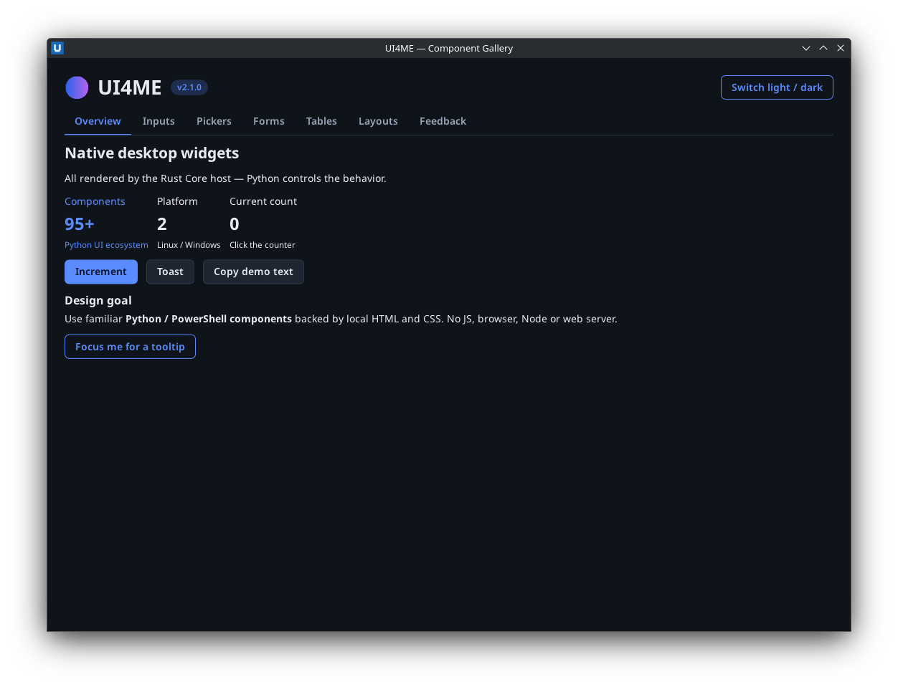
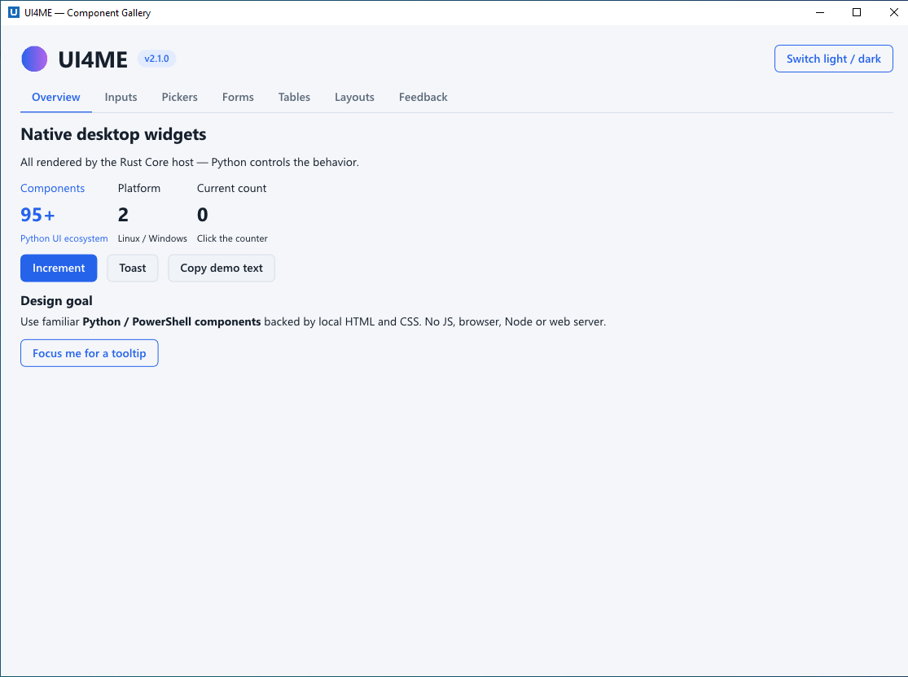
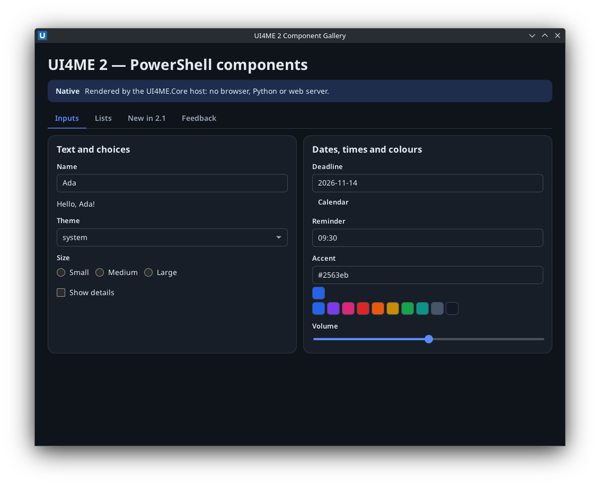
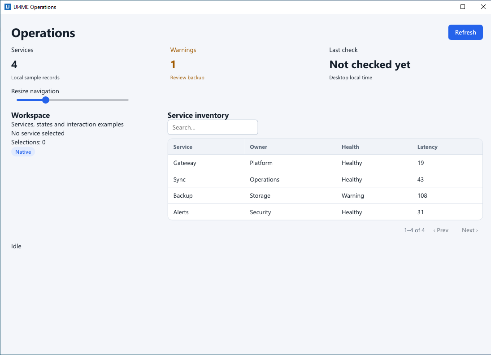

# UI4ME

**Build native desktop applications with Python or PowerShell, using familiar components and local HTML/CSS — without JavaScript, Electron, WebKit, Chromium or a local web server.**

UI4ME is the high-level component layer built on [UI4ME Core](https://github.com/ui4me/ui4me-core). Core owns rendering, desktop windows, input and accessibility; UI4ME handles controls, state, forms, tables, layouts, themes and your application logic. Choose Python or PowerShell. Both run as ordinary scripts.

[Documentation](https://github.com/ui4me/ui4me/blob/main/docs/index.md) · [Component catalog](https://github.com/ui4me/ui4me/blob/main/docs/components/index.md) · [Gallery](https://github.com/ui4me/ui4me/blob/main/docs/gallery.md) · [Python API](https://github.com/ui4me/ui4me/blob/main/docs/reference/python-api.md) · [PowerShell API](https://github.com/ui4me/ui4me/blob/main/docs/reference/powershell-api.md) · [Releases](https://github.com/ui4me/ui4me/releases)

[](https://github.com/ui4me/ui4me/actions/workflows/ci.yml) [](https://pypi.org/project/ui4me/) [](https://www.powershellgallery.com/packages/UI4ME) [](LICENSE)

<details>
<summary><b>Install on Linux — Python / uv / pip</b></summary>

Python 3.11+, Linux x64, glibc 2.34+, Wayland desktop (KDE Plasma 6 qualified).

```bash
uv init --bare my-app && cd my-app
uv add ui4me
# or: python -m pip install ui4me    (inside a virtual environment)
```

No Rust compiler or native host installation step: the `ui4me-core` wheel is installed automatically.

[Full Linux/Python install guide](https://github.com/ui4me/ui4me/blob/main/docs/guides/install-python.md)
</details>

<details>
<summary><b>Install on Windows — Python</b></summary>

Python 3.11+, Windows x64:

```powershell
uv init --bare my-app; cd my-app
uv add ui4me
# or: py -m pip install ui4me    (inside a virtual environment)
```

[Python quickstart](https://github.com/ui4me/ui4me/blob/main/docs/guides/quickstart-python.md)
</details>

<details>
<summary><b>Install PowerShell — Linux, Windows and Windows PowerShell 5.1</b></summary>

PowerShell 7.2+ on Linux/Windows x64, or Windows PowerShell 5.1 on Windows x64:

```powershell
Install-Module UI4ME -Scope CurrentUser
Import-Module UI4ME
```

The module depends on `UI4ME.Core` 1.0.1+. There is **no Python runtime dependency**.

[PowerShell quickstart](https://github.com/ui4me/ui4me/blob/main/docs/guides/quickstart-powershell.md)
</details>

<details>
<summary><b>Documentation and recipes</b></summary>

- [Python quickstart](https://github.com/ui4me/ui4me/blob/main/docs/guides/quickstart-python.md) · [PowerShell quickstart](https://github.com/ui4me/ui4me/blob/main/docs/guides/quickstart-powershell.md)
- [All components](https://github.com/ui4me/ui4me/blob/main/docs/components/index.md) · [Gallery and demos](https://github.com/ui4me/ui4me/blob/main/docs/gallery.md)
- [Python recipes](https://github.com/ui4me/ui4me/blob/main/docs/recipes/python.md) · [PowerShell recipes](https://github.com/ui4me/ui4me/blob/main/docs/recipes/powershell.md)
- [Reactive state](https://github.com/ui4me/ui4me/blob/main/docs/concepts/reactivity.md) · [Theming](https://github.com/ui4me/ui4me/blob/main/docs/concepts/theming.md) · [Application lifecycle](https://github.com/ui4me/ui4me/blob/main/docs/concepts/lifecycle.md)
- [Compatibility and limitations](https://github.com/ui4me/ui4me/blob/main/docs/reference/compatibility.md) · [Troubleshooting](https://github.com/ui4me/ui4me/blob/main/docs/guides/troubleshooting.md)
</details>

<details>
<summary><b>Teach your coding agent UI4ME</b></summary>

The Python and PowerShell distributions include high-level coding-agent skills for Claude Code, Codex, OpenCode, Copilot, Cursor and Gemini CLI. Use the separate Core skills for low-level native APIs.

```bash
ui4me-ui-skill install --agents all --scope user
# or just Claude Code in a repository:
ui4me-ui-skill install --agents claude --scope project --project .
```

```powershell
Install-UI4MEUiSkill -Agents all -Scope user
```

Installers manage only their own skill files and protect existing modified/unmanaged directories. [Installation details](https://github.com/ui4me/ui4me/blob/main/docs/guides/agent-skills.md).
</details>

## The desktop UI you actually want to build

UI4ME supplies component-level building blocks, without requiring web development or JavaScript glue:

| Build | Available high-level features |
| --- | --- |
| **Forms and utilities** | Inputs, validation, conditional forms, state, date/time/color, file pickers |
| **Dashboards** | Responsive layout, cards, metrics, tables, sorting, filtering, paging, progress |
| **Applications** | Multiple windows in Python, settings, navigation, commands, background work |
| **Interactive controls** | Tabs, keyed lists, drawers, menus, dialogs, notifications, tooltips |
| **Advanced views** | Markdown, chat, logs, trees, mini charts and CSS themes in Python; essential PowerShell equivalents |

UI4ME is small because it delegates the native renderer and desktop platform work to Core. **It is not a full browser**, and advanced native OS features unsupported by Core cannot be promised. See [limitations](https://github.com/ui4me/ui4me/blob/main/docs/concepts/core-integration.md).

### Component gallery

The checked-in galleries are **real executable apps**, not mockups:

```bash
python examples/python/gallery.py
```

```powershell
pwsh -File ./examples/powershell/gallery.ps1
```

| Python gallery — KDE Plasma 6 (Wayland, dark) | Python gallery — Windows Server 2022 |
| --- | --- |
|  |  |
| **PowerShell gallery — KDE Plasma 6 (pwsh 7)** | **Operations dashboard — Windows (Python)** |
|  |  |

These screenshots were captured from the unmodified example apps during the 2.1.0 native qualification (see [docs/images/PROVENANCE.md](https://github.com/ui4me/ui4me/blob/main/docs/images/PROVENANCE.md)). Visit [Gallery and example applications](https://github.com/ui4me/ui4me/blob/main/docs/gallery.md) for the settings, dashboard and file-utility demos.

## Your first Python app

Install `ui4me`, save this as `app.py` and run `python app.py` or `uv run app.py`:

```python
from ui4me import ui


def main():
    with ui.app('My first app', width=540, height=340) as app:
        name = ui.input('Your name', placeholder='Ada')
        result = ui.text('Hello!')

        def greet(event):
            result.set('Hello, ' + (name.value or 'world') + '!')

        with ui.row():
            ui.button('Greet', on_click=greet)
            ui.button('Quit', on_click=app.stop, variant='secondary')

    app.run()


if __name__ == '__main__':
    main()
```

UI4ME calls Core's new direct-start helper behind the scenes. There is **no `app.toml`**, no manual `ui4me-host run`, and no browser. A normal script is re-executed once as a supervised backend: keep initialization side effects after bootstrap.

## Your first PowerShell app

Install the `UI4ME` module, save as `app.ps1`, run `pwsh -File ./app.ps1` (or `powershell.exe -File .\app.ps1` on Windows PowerShell 5.1):

```powershell
$ErrorActionPreference = 'Stop'
Import-Module UI4ME

Invoke-UI4MEApp -Title 'My first app' -Content {
    $count = New-UI4MEState -Value 0
    New-UI4MEHeading -Text 'Native PowerShell UI'
    New-UI4METext -Bind $count
    New-UI4MEButton -Text 'Click' -OnClick {
        $count.Set([int]$count.Value + 1)
    }
}
```

The high-level module uses Core's `Start-UI4MEScript` to supervise the native process. No direct host command and no Python dependency.

## Supported platforms and status

- **UI4ME 2.1.0** was qualified with real keyboard/mouse input (and real pinyin IME composition) on **Debian 13 / KDE Plasma 6 Wayland** and **Windows Server 2022**, for Python 3.13 and for PowerShell 7 and Windows PowerShell 5.1, on top of the published **UI4ME Core 1.0.1**. What was tested, and what was not, is listed in the [feature matrix](https://github.com/ui4me/ui4me/blob/main/docs/reference/feature-matrix.md) and the [2.1.0 release notes](https://github.com/ui4me/ui4me/blob/main/docs/release/RELEASE_NOTES_2.1.0.md).
- Python requires 3.11+; PowerShell 7.2+ on Linux/Windows, or Windows PowerShell 5.1 on Windows. x64 only. macOS, X11 and ARM are not qualified.
- Screen-reader output, HiDPI scaling and multi-monitor setups were not part of the automated qualification.

This repository intentionally separates **high-level UI components** from [UI4ME Core](https://github.com/ui4me/ui4me-core), the lower-level native runtime. Licensed under [MIT](LICENSE).
