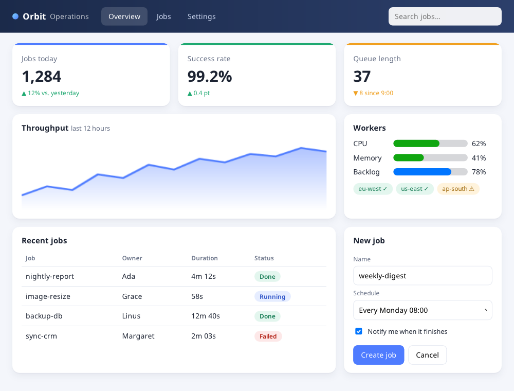
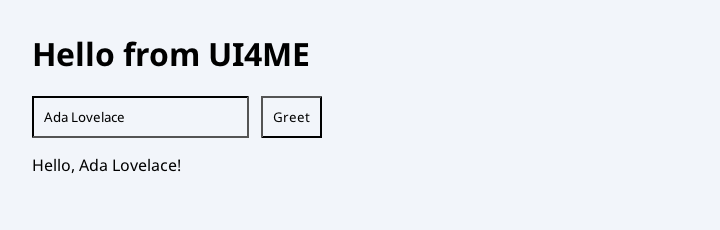
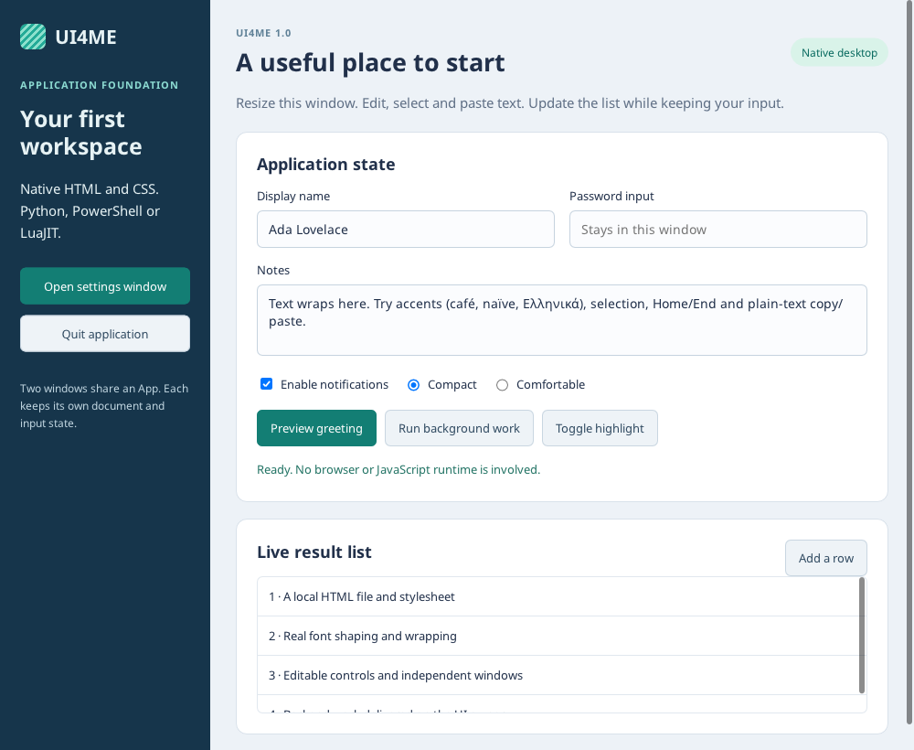

# UI4ME

**Native desktop apps from HTML and CSS — driven by Python, PowerShell or LuaJIT.**

You describe the interface in HTML and CSS; UI4ME renders it in a real native window with its
own Rust engine: layout, text shaping, painting, input, accessibility and OS integration. Your
application logic stays in your language. There is no browser, webview or JavaScript engine
inside, and nothing is loaded from the network.



*`examples/showcase`: an HTML file and a stylesheet, opened from Python. CSS grid, gradients,
shadows, an inline SVG chart, meters, a table and form controls.*

| | |
| --- | --- |
| **Version** | 1.0.0 (stable; [compatibility promise](docs/COMPATIBILITY.md)) |
| **Platforms** | Linux x86-64 (Wayland, X11) · Windows x64 |
| **Languages** | Python 3.11–3.14 · PowerShell 7.4+ · LuaJIT 2.1 · C |
| **Packages** | [PyPI `ui4me`](https://pypi.org/project/ui4me/) · [PowerShell Gallery `Ui4me`](https://www.powershellgallery.com/packages/Ui4me/) · [GitHub releases](https://github.com/ui4me/ui4me/releases/latest) (LuaJIT, C SDK) |
| **License** | [MIT](LICENSE) |

## Install

```sh
pip install ui4me
```

```powershell
Install-PSResource Ui4me
```

The packages include the native library, so you don't need Rust, a compiler or a .NET SDK. For
LuaJIT or C, download `ui4me-lua-1.0.0.zip` or the native SDK zip from the
[latest release](https://github.com/ui4me/ui4me/releases/latest).

## Quick start

### Python

```python
from ui4me import App

with App() as app:
    window = app.open('''
        <style>
          body { font-family: sans-serif; padding: 24px; background: #f2f5fa; }
          .row { display: flex; gap: 12px; align-items: center; }
          input, button { padding: 10px; }
        </style>
        <h1>Hello from UI4ME</h1>
        <div class="row">
          <input id="name" value="Ada Lovelace">
          <button id="greet">Greet</button>
        </div>
        <p id="status">Ready.</p>
    ''', width=720, height=230)

    def greet(event):
        window.set_text("status", f"Hello, {window.get_value('name')}!")

    window.on("click", greet, element="greet")
    app.run()
```



### PowerShell

```powershell
Import-Module Ui4me
Invoke-Ui4meApp {
    param($app)
    $window = New-Ui4meWindow @'
<style>body { font-family: sans-serif; padding: 24px; }
input, button { padding: 10px; }</style>
<h1>Hello from UI4ME</h1>
<input id="name" value="Ada Lovelace">
<button id="greet">Greet</button><p id="status">Ready.</p>
'@
    $null = Register-Ui4meEvent $window click {
        $window.SetText('status', "Hello, $($window.GetValue('name'))!")
    } -Element greet
}
```

### LuaJIT

```lua
local ui4me = require("ui4me")   -- ui4me.lua from the release zip; the native library sits next to it
local app = ui4me.App{ app_id = "org.example.hello" }
local win = app:open([[<input id="name" value="Ada Lovelace"><button id="greet">Greet</button>
<p id="status">Ready.</p>]], { title = "Hello", width = 480, height = 240 })
win:on("click", function() win:set_text("status", "Hello, " .. win:get_value("name") .. "!") end,
       { element = "greet" })
app:run()
app:close()
```

## Building an app from HTML and CSS files

Real applications keep their interface in files. `open_file` loads an HTML file, and the file's
directory becomes the window's **asset root**: stylesheets, images and fonts next to it load
with ordinary relative URLs. Nothing outside that directory, and nothing from the network, is
ever loaded.

```text
my_app/
├── app.py
└── ui/
    ├── index.html      <link rel="stylesheet" href="style.css">  
    ├── style.css       @font-face { src: url(fonts/Inter.woff2) }
    ├── logo.png
    └── fonts/Inter.woff2
```

```python
from pathlib import Path
from ui4me import App

UI = Path(__file__).parent / "ui"

with App() as app:
    window = app.open_file(UI / "index.html", title="My app", width=1000, height=760)

    def save(event):
        name = window.get_value("name")
        window.set_text("status", f"Saved {name}")

    window.on("click", save, element="save")
    window.on("input", lambda e: window.set_text("count", str(len(e["value"]))), element="name")
    app.run()
```

```powershell
Invoke-Ui4meApp -ArgumentList "$PSScriptRoot/ui" {
    param($app, $ui)
    $window = $app.OpenFile("$ui/index.html", 'My app', 1000, 760)
    $null = $window.On('click', { $window.SetText('status', "Saved $($window.GetValue('name'))") }, 'save')
}
```

From there, the document is programmable: change text, values, classes and attributes, insert
or remove HTML fragments, add stylesheets at run time, open more windows, run work in the
background and show native dialogs. The two runnable examples below are built this way:

| `examples/showcase` (`python examples/python/showcase.py`) | `examples/foundation` (`python examples/python/hello.py`) |
| --- | --- |
|  |  |

<details>
<summary><b>More examples</b></summary>

| Example | Shows |
| --- | --- |
| `examples/python/hello.py`, `examples/powershell/hello.ps1` | The foundation app: local HTML/CSS and images, form controls, a second window, background work |
| `examples/python/showcase.py` | A file-based dashboard with tabs and a form that appends table rows |
| `examples/python/chat_log.py`, `.ps1` | A chat and streaming log: Enter to send, Shift+Enter for a new line, follow-the-end scrolling, bounded history |
| `examples/python/file_utility.py`, `.ps1` | Native open/save/folder dialogs, file drops, a file list |
| `examples/python/data_viewer.py`, `.ps1` | 20,000 rows paged 200 at a time, filter and sort in the background, keyboard selection, detail windows, PDF export |
| `examples/lua/notes.lua` | A notes list in LuaJIT |

To run an example from a source checkout instead of an installed package, see
[DEVELOPMENT.md](docs/DEVELOPMENT.md#running-from-a-checkout).

</details>

## What you can build with

**HTML and CSS.** A fixed, versioned subset of the web platform, chosen for desktop UIs.

<details>
<summary><b>Supported HTML and CSS</b></summary>

- **Layout:** block, inline, flexbox, grid, multicolumn, floats, absolute/fixed/sticky
  positioning, tables, overflow and scrolling, scroll snapping, smooth scrolling, media queries
  (including `prefers-color-scheme`, `prefers-reduced-motion`), custom properties
  (`var()`), `calc()`, `light-dark()`.
- **Visuals:** colours and gradients, borders and radii, box and text shadows, opacity, filters
  and `backdrop-filter`, clip paths and masks, transforms, images (PNG, JPEG, GIF, WebP, BMP,
  SVG), inline SVG (static profile, with clickable shapes), scrollbar colours and widths.
- **Text:** shaped Unicode text with font fallback (any script, bidi, emoji), system fonts and
  local `@font-face`, `text-overflow: ellipsis`, hyphenation in nine languages, vertical text.
- **Motion:** CSS transitions and keyframe animations, `@starting-style`. Idle windows use no CPU.
- **Controls:** text, password, number, range, checkbox, radio, file inputs, textarea, buttons,
  `<select>` (drop-down and list), `<dialog>` (modal), `<details>`, popovers with anchor
  positioning, `<progress>`, `<meter>`, form validation and submission.
- **Editing:** `contenteditable` hosts — plain text, or rich text with bold, italic, underline,
  links, paragraphs, sanitized paste and undo.
- **Printing:** `@page` (sizes, margins, margin boxes, page numbers), page breaks.
- **Not supported:** JavaScript, `<iframe>`, network resources, video and audio. Unsupported CSS
  is ignored and reported by `get_diagnostics()`, never half-applied. The full list is the
  generated [support profile](docs/SUPPORT_PROFILE_V1.json).

</details>

**Desktop integration.** Real native windows and OS services, with each platform's limits
reported honestly instead of failing silently.

<details>
<summary><b>Native windows and OS services</b></summary>

- Multiple windows; title, size, size constraints, icon, minimize/maximize/fullscreen,
  show/hide, focus, monitor information, close veto.
- Native open, save and folder dialogs; file drops.
- Clipboard (text and sanitized HTML), drag and drop inside documents.
- Notifications, tray icon with menu, window menu bars and context menus with accelerators,
  global shortcuts.
- Dark and high-contrast preference, live theme changes (Windows).
- Keyboard layouts, dead keys, AltGr and IME composition (Japanese, Korean and others).
- Touch and pointer events with pointer capture.
- Printing through the system print dialog, PDF export, rendering pages to PNG.
- Single-instance apps that receive "open with" files.
- Accessibility: every control works from the keyboard, and screen readers see roles, names,
  states and text through AT-SPI (Linux) and UI Automation (Windows); checked with Orca and
  NVDA.
- `capabilities()` says what the current platform supports. On Wayland, for example, an app
  cannot focus or hide its own window.

</details>

## Language bindings

All bindings sit on the same C ABI and the same JSON commands, so they behave identically.

<details>
<summary><b>Python — <code>ui4me</code></b></summary>

- `App`: `open(html)`, `open_file(path)`, `run()`, `stop()`, `post(fn)` (thread-safe, returns a
  future), `timer(ms, fn)`, `run_in_background(fn, on_done=...)`, `on(event, fn)`,
  `capabilities()`, notifications, tray, global shortcuts, link policy, single instance.
- `Window`: a method for every public operation —
  - content: `set_text`, `get_text`, `set_value`, `get_value`, `set_checked`, attributes and
    classes, `insert_html`/`append_html`/`replace_children_html`, `remove_element`,
    `move_element`, `batch`, `append_text`, `trim_children`, `get_html`, `query(selector)`;
  - styles: `add_stylesheet`, `replace_stylesheet`, `computed_style`;
  - geometry and scrolling: `get_rect`, `text_rects`, `scroll_to`, `scroll_into_view`,
    `set_scroll_follow`;
  - selection and clipboard, dialogs (`show_dialog`, `open_file_dialog`, …), popovers, menus,
    window actions, pagination (`paginate`, `export_pdf`, `print_document`), rich editing
    (`exec_edit`), diagnostics (`get_diagnostics`, `explain`), `snapshot(path)`.
- `window.on("click" | "input" | "commit" | "keydown" | …, handler, element="id")`.
- `python -m ui4me demo` runs the bundled foundation app.

</details>

<details>
<summary><b>PowerShell — <code>Ui4me</code></b></summary>

- `Invoke-Ui4meApp { param($app) ... }` runs the app on a dedicated UI thread in a fresh runspace;
  pass outside values with `-ArgumentList`.
- Cmdlets: `New-Ui4meWindow`, `Register-Ui4meEvent`, `Set-Ui4meText`, `Get-Ui4meValue`,
  `Set-Ui4meValue`, `Get-Ui4meChecked`, `Set-Ui4meChecked`, `Stop-Ui4meApp`, `Get-Ui4meInfo`.
- The `$app` and `$window` objects expose the same operations as Python in PascalCase
  (`$window.SetText`, `$window.AppendHtml`, `$window.ExportPdf`, `$app.RunInBackground`,
  `$app.Notify`, …); JSON-returning methods end in `Json`.
- `$app.Work` / `$app.RunInBackground` run script blocks in isolated background runspaces and
  deliver results on the UI thread.

</details>

<details>
<summary><b>LuaJIT — <code>ui4me.lua</code></b></summary>

- One FFI file, no compiled glue. `ui4me.App{...}` with `open`, `open_file`, `on`, `timer`,
  `post`, `run`, `stop`, `capabilities`, `close`.
- `Window` methods for text, values, checked state, attributes, classes, focus, HTML insertion,
  `append_text`, `remove_element`, `move_element`, `trim_children`, `query`, `get_rect`,
  `batch`, `set_title`, `resize`, `diagnostics`.
- Every other operation is available through `win:command{ op = "...", ... }` with the fields
  documented in the [API reference](docs/API.md).
- Loads the native library next to `ui4me.lua`, or the absolute path in `UI4ME_NATIVE_LIB`.

</details>

<details>
<summary><b>C</b></summary>

`include/ui4me.h` (ABI 1): create a session, send JSON commands, receive JSON events through a
callback, run the event loop. The [API reference](docs/API.md#c-abi-and-errors) describes
threading, error codes and ownership rules.

</details>

## How it works

<details>
<summary><b>Architecture in one paragraph</b></summary>

Your code creates an `App` and windows on one thread (the owner thread). Each window holds a
document; Core parses the HTML, applies CSS with Mozilla's Stylo engine, lays it out with
Taffy, shapes text, rasterizes on the CPU and presents the pixels in a native window. Input
goes the other way: OS events become DOM events, and the ones you subscribed to are delivered
to your handlers on the owner thread. Background work and other threads talk to the app only
through `post` and background tasks. Element identity is generational, so an event for an
element you have since removed is dropped rather than misdelivered. Every queue, cache and
input size is bounded. Details: [project summary](docs/PROJECT_SUMMARY.md).

</details>

## Known limits

- Software rendering only; no macOS or ARM64 builds yet.
- Updates stay smooth up to about a thousand rows of a log or table; keep larger data paged
  (as the data viewer example does). A document holds at most 65,536 nodes.
- PDF export and printing are raster images (text not selectable).
- Rich editing covers formatting, links and paragraphs, not lists, tables or images.

The complete list is in the
[project summary](docs/PROJECT_SUMMARY.md#known-limitations-and-technical-debt).

## Documentation

| Document | Contents |
| --- | --- |
| [Project summary](docs/PROJECT_SUMMARY.md) | Scope, architecture, platforms, release status, limitations |
| [API reference](docs/API.md) | The public contract for every binding and the C ABI |
| [Development](docs/DEVELOPMENT.md) | Building from source, testing, contributing, releasing |
| [Compatibility](docs/COMPATIBILITY.md) | What 1.x keeps stable |
| [Changelog](CHANGELOG.md) | What each release added |

## Building from source

```sh
python -m venv .venv && source .venv/bin/activate    # .\.venv\Scripts\Activate.ps1 on Windows
python -m pip install -r requirements-dev.txt
python dev.py build --binding all --profile dev
python dev.py test --binding all --suite unit --profile dev
```

This needs Rust 1.99.1 (selected by `rust-toolchain.toml`), the .NET 10 SDK, PowerShell 7.4+ and
a C compiler. See [DEVELOPMENT.md](docs/DEVELOPMENT.md) for the details.

<details>
<summary><b>Repository layout</b></summary>

| Path | Contents |
| --- | --- |
| `crates/` | The Rust engine and native host (`ui4me-core` exposes the C ABI in `include/ui4me.h`) |
| `bindings/` | Python, PowerShell and LuaJIT bindings |
| `patches/` | Carried Stylo, Taffy and AccessKit sources with UI4ME corrections |
| `examples/` | Example applications |
| `tests/` | Native desktop journeys, packaging, soak and tooling tests |
| `tools/`, `dev.py`, `scripts/`, `.github/` | Build, packaging, release gates and publication |

</details>
